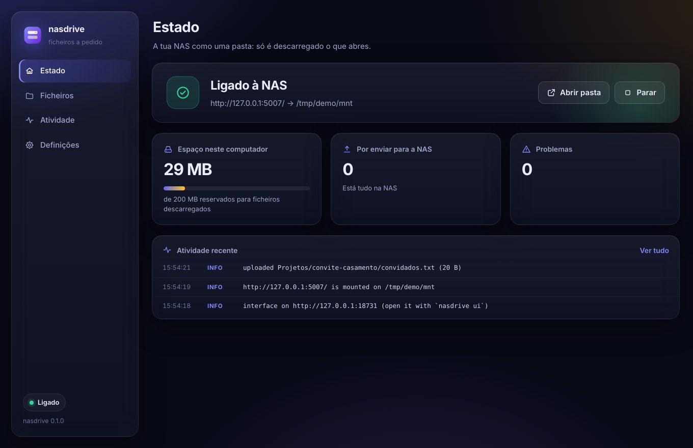
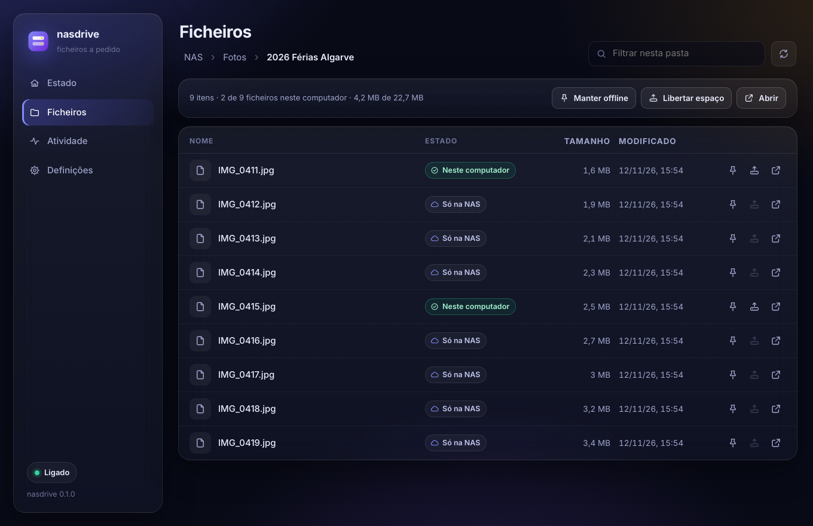

# NASYNCLOUD

**A tua NAS como nuvem.** Ficheiros a pedido ("Files On-Demand") para uma NAS com WebDAV. Foi pensado para a UGREEN (UGOS), mas não tem nada específico dela. A NAS aparece como uma pasta normal: vês tudo o que lá está, mas só é descarregado o que abres.



- **Navegar** não descarrega nada; os tamanhos e datas são os da NAS.
- **Abrir um ficheiro** descarrega só a parte lida. Um vídeo de 10 GB começa logo a dar, e saltar para o meio não puxa o início.
- **Manter offline** um ficheiro ou pasta descarrega-o todo e mantém-no atualizado, incluindo ficheiros novos que apareçam na NAS.
- **Libertar espaço** apaga a cópia local mas deixa o ficheiro visível.
- **Alterações locais** (ficheiros novos, edições, pastas) vão primeiro para o disco e sobem em segundo plano. Sem NAS, ficam em fila e seguem quando ela voltar, mesmo depois de reiniciar.
- **Uploads** vão para um nome temporário e só no fim substituem o original, por isso uma falha a meio nunca deixa um ficheiro cortado na NAS.
- **Conflitos**: se um ficheiro mudou cá e na NAS, ficam os dois. O teu passa a `nome (conflict 2026-11-12 153012).ext`.
- **Interface** no browser para configurar, ver o estado, gerir o que fica offline e acompanhar a atividade.

## Estado por plataforma

| | Motor | Testado |
|---|---|---|
| Linux | FUSE | Sim: 28 testes automáticos + 64 verificações num mount real, incluindo a interface |
| macOS | FUSE (precisa do macFUSE) | Sim: 28 testes automáticos + 63 verificações num mount real, incluindo a interface (macOS 27, Apple Silicon, macFUSE 5.5) |
| Windows | Cloud Files API (a do OneDrive) | Só compila; nunca correu |

Também **nunca foi testado contra o WebDAV da UGOS em si**, só contra o do rclone e o `dav-server`. Experimenta primeiro numa pasta partilhada de teste.

## 1. Preparar a NAS

1. Na UGOS: **Painel de Controlo → Serviço de Ficheiros → WebDAV**, ativar e **Aplicar**. Portas por omissão: `5005` (HTTP) e `5006` (HTTPS).
2. Nas **Definições avançadas** do WebDAV, ativa "Remover o limite de 1024 caracteres no caminho" se tiveres pastas muito fundas.
3. Confirma que o teu utilizador tem leitura/escrita na pasta partilhada.

O endereço é `http://IP_DA_NAS:5005/NomeDaPasta` (o nome é sensível a maiúsculas). Em casa o HTTP chega. Fora de casa usa HTTPS através de uma VPN (Tailscale, WireGuard) em vez de abrir portas no router.

## 2. Instalar

### Pronto a usar

Em [Releases](https://github.com/PedroGrilo/NASYNCLOUD/releases) há uma versão para macOS e outra para Windows. Cada uma é gerada pelo GitHub Actions a partir de uma tag `v*`, depois de passar nos testes.

- **macOS** (Apple Silicon): `NASYNCLOUD-…-macos-arm64.dmg`. Primeiro instala o [macFUSE](https://macfuse.github.io/) 5.5 ou mais recente, autoriza a extensão de sistema e reinicia. Depois abre o `.dmg` e arrasta o NASYNCLOUD para Aplicações. A app não está assinada pela Apple: na primeira vez, vai a Definições do Sistema → Privacidade e segurança → «Abrir mesmo assim». Fica na barra de menus (ver «A app» abaixo). O registo está em `~/Library/Logs/nasyncloud.log`.
- **Windows**: `NASYNCLOUD-…-windows-x86_64.zip`, com o `nasyncloud-desktop.exe` (a app, é este que se abre) e o `nasyncloud.exe` (o serviço que ela arranca). Têm de ficar na mesma pasta. Ainda é experimental. O SmartScreen pode avisar: «Mais informações» → «Executar mesmo assim».
- **Linux**: não há pacote; compila a partir do código (ver abaixo).

### Compilar

Precisas do Rust 1.90 ou mais recente (`rustup`).

**Linux** (Debian/Ubuntu):
```sh
sudo apt install fuse3 pkg-config libssl-dev
cargo build --release      # binário em target/release/nasyncloud
```

**macOS**: instala o [macFUSE](https://macfuse.github.io/) 5.5 ou mais recente e segue as instruções dele para permitir a extensão de sistema. O NASYNCLOUD usa o motor clássico (kext) do macFUSE, por isso a extensão tem de estar autorizada e é preciso reiniciar. Depois:
```sh
brew install pkg-config
cargo build --release
tools/package-macos.sh     # opcional: dist/NASYNCLOUD.app e o .dmg
```

**Windows** (toolchain MSVC, Windows 10 1709 ou mais recente, pasta num disco NTFS):
```powershell
cargo build --release      # target\release\nasyncloud.exe
```

## 3. Usar

### A app (barra de menus / área de notificação)

É a forma pensada para o dia a dia, como o OneDrive. O ícone fica na barra de menus do Mac (em cima, à direita) ou na área de notificação do Windows (em baixo, à direita). Clicar nele abre um painel com:

- o estado («Tudo atualizado», «A enviar 3 ficheiros», «NAS inacessível», …);
- o que está a ser transferido, com progresso, e o que foi enviado e descarregado há pouco. Clicar num ficheiro abre-o, e o ícone de pasta mostra onde está;
- o espaço usado neste computador;
- a roda dentada, com «Abrir o NASYNCLOUD» (a interface completa numa janela), «Definições», «Pausar sincronização» e «Sair».

Na primeira vez abre logo as Definições. A app arranca sozinha o serviço `nasyncloud serve` que vem com ela, e o «Sair» espera pelos envios pendentes antes de fechar. Para compilar a app: `cargo build -p nasyncloud-desktop` (no macOS, `tools/package-macos.sh` gera o `.app` e o `.dmg`).

### Linha de comandos e browser

```sh
nasyncloud        # o mesmo que: nasyncloud ui
```

Abre a interface no browser e arranca o NASYNCLOUD, se ainda não estiver a correr. Na primeira vez vai direta às **Definições**: endereço WebDAV, utilizador, password e a pasta local onde a NAS deve aparecer. **Testar ligação** confirma tudo antes de guardar e **Guardar e ligar** monta a NAS. Se usares HTTPS com o certificado que vem com a UGOS, o teste avisa que não o consegue verificar e oferece-se para confiar nele.

A interface tem quatro secções:

- **Estado**: ligação, espaço usado, o que falta enviar, problemas e atividade recente, com botões para abrir a pasta e para parar/iniciar. O botão «Sair», em baixo na barra lateral, desmonta a pasta e encerra o NASYNCLOUD, mas só depois de terminar os envios pendentes.
- **Ficheiros**: navegas na NAS e vês o estado de cada ficheiro (só na NAS, parcialmente aqui, neste computador, por enviar). Manter offline, libertar espaço e abrir, por ficheiro ou por pasta.
- **Atividade**: o registo do que o NASYNCLOUD fez.
- **Definições**: a ligação e as opções avançadas.



O NASYNCLOUD continua a correr enquanto o terminal (ou o serviço) estiver aberto; fechar o separador do browser não o para. Voltar a correr `nasyncloud` só reabre a interface. No Windows, um duplo clique no `nasyncloud.exe` faz o mesmo; a janela de consola que aparece é o próprio NASYNCLOUD e fechá-la para-o.

A password fica no cofre do sistema (Gestor de Credenciais no Windows, Porta-chaves no macOS, Secret Service no Linux). Se não houver cofre, a interface pergunta se a pode guardar no ficheiro de definições. Também podes usar a variável `NASYNCLOUD_PASSWORD`.

### Sem browser

```sh
nasyncloud setup     # as mesmas perguntas, no terminal
nasyncloud mount     # monta e sincroniza até Ctrl+C; a interface fica disponível
```

Com o `mount` a correr, `nasyncloud ui` abre a interface a qualquer momento.

### Linux e macOS na linha de comandos

A pasta comporta-se como qualquer outra (`cp`, `mv`, editores, `rsync`...). Para gerir o que fica local sem a interface:

```sh
nasyncloud status                 # estado geral: ligação, cache, uploads pendentes
nasyncloud ls ~/NAS/Fotos         # estado de cada entrada
nasyncloud pin ~/NAS/Documentos   # manter offline
nasyncloud unpin ~/NAS/Documentos
nasyncloud free ~/NAS/Videos      # libertar espaço já
nasyncloud refresh ~/NAS/Fotos    # reler da NAS agora
nasyncloud unmount                # se uma sessão anterior ficou pendurada
```

No Linux, `du` mostra o espaço que cada coisa ocupa mesmo no disco; `ls -l` mostra o tamanho real na NAS. No macOS, o `du` mostra sempre o tamanho todo (o macFUSE não deixa mudar isso): usa `nasyncloud ls` ou `nasyncloud status`.

### Windows

Para além da interface, tudo funciona no Explorador: a pasta aparece no painel lateral com os ícones de nuvem (só online) e visto verde (no disco). Clique direito → **Manter sempre neste dispositivo** ou **Libertar espaço**. O Sensor de Armazenamento também pode libertar espaço sozinho. Para remover o registo da pasta no Windows (os ficheiros na NAS não são tocados): `nasyncloud unregister`.

## Arrancar automaticamente

Corre `nasyncloud mount` no arranque; a interface abre-se depois com `nasyncloud ui`.

**Linux (systemd)**: `~/.config/systemd/user/nasyncloud.service`
```ini
[Unit]
Description=nasyncloud
After=network-online.target

[Service]
ExecStart=%h/.cargo/bin/nasyncloud mount
Restart=on-failure

[Install]
WantedBy=default.target
```
e depois `systemctl --user enable --now nasyncloud`.

**Windows**: no Agendador de Tarefas, uma tarefa "Ao iniciar sessão" que corre `nasyncloud.exe mount`.

**macOS**: um LaunchAgent em `~/Library/LaunchAgents` com `ProgramArguments` = `nasyncloud mount` e `KeepAlive` ativo.

## Configuração

A interface mostra onde está o ficheiro (no Linux, `~/.config/nasyncloud/config.toml`). Também podes usar `--config caminho`. Opções avançadas (todas editáveis na interface):

| Chave | Omissão | O que faz |
|---|---|---|
| `cache_max_size` | `"20G"` | Limite da cache (Linux/macOS). Acima disto, os ficheiros usados há mais tempo são libertados. Fixados e modificados nunca. |
| `cache_dir` | pasta de cache do sistema | Onde ficam os dados descarregados e o índice. |
| `dir_ttl_secs` | `30` | Quanto tempo uma listagem de pasta é usada antes de perguntar à NAS outra vez. |
| `poll_interval_secs` | `300` | De quanto em quanto tempo as pastas fixadas (e, no Windows, todas as pastas já abertas) são comparadas com a NAS. |
| `upload_delay_secs` | `2` | Pausa depois de fechar um ficheiro antes de o enviar. |
| `parallel_uploads` | `2` | Uploads em simultâneo. |
| `readahead_mb` | `8` | Quanto o download pode ir à frente da leitura. |
| `atomic_upload` | `true` | Upload para nome temporário + renomear. Se a NAS não deixar, passa sozinho para upload direto. |
| `accept_invalid_certs` | `false` | Aceitar certificados HTTPS que não se conseguem verificar. |
| `ui_port` | `8730` | Porta da interface (`http://127.0.0.1:8730`). |

`-v` dá mais detalhe no registo.

## Segurança da interface

- Só escuta em `127.0.0.1`; não é acessível de outros computadores.
- A API exige um token aleatório de 256 bits, guardado em `ui.json` ao lado das definições (só a tua conta o lê). `nasyncloud ui` abre o browser já com ele.
- Pedidos com outro `Host` são recusados (proteção contra DNS rebinding) e a página tem uma Content-Security-Policy restritiva.
- Quem tem acesso à tua conta no computador consegue usar a interface, tal como consegue abrir a pasta da NAS.

## Limitações conhecidas

- **Linux/macOS**: apagar ou renomear algo que já está na NAS precisa da NAS acessível (dá "Host is down" offline). Criar e editar funciona offline. Pastas nunca abertas não se podem ver offline.
- **Windows**: as alterações feitas na NAS por outros dispositivos só aparecem na sondagem seguinte (`poll_interval_secs`, mínimo 15 s). Nomes que o Windows não aceita (`:`, `?`, `CON`...) são ignorados, com aviso.
- **macOS**: não há ícones de estado no Finder (isso exigiria uma extensão de sistema assinada). O `du` não reflete o que está no disco (ver acima). O `cp` avisa «could not copy extended attributes» quando o ficheiro tem atributos `com.apple.*`: o ficheiro é copiado inteiro, só esses atributos é que não vão para a NAS. O motor FSKit do macFUSE ainda não funciona com o NASYNCLOUD.
- Permissões (`chmod`/`chown`), links simbólicos e atributos estendidos não são guardados na NAS.
- `.DS_Store`, `Thumbs.db`, `desktop.ini`, `~$*`, `*.tmp` e afins ficam só no computador.
- Os uploads deixam temporariamente ficheiros `.*.nasyncloud-part` na NAS; restos com mais de um dia são apagados sozinhos.
- As mensagens da secção Atividade (e da linha de comandos) estão em inglês.

## Para quem desenvolve

- [`CLAUDE.md`](CLAUDE.md): contexto rápido do projeto, comandos e armadilhas. Lê primeiro.
- [`docs/ARCHITECTURE.md`](docs/ARCHITECTURE.md): como funciona por dentro.
- [`docs/DECISIONS.md`](docs/DECISIONS.md): porque é que foi feito assim.
- [`CHANGELOG.md`](CHANGELOG.md).
- Testes: `cargo test`; num mount real (Linux ou macOS), `cargo build && cargo build --example fake_nas && tests/e2e.sh` (usa o rclone como NAS se estiver instalado, senão a NAS falsa `examples/fake_nas.rs`). Ambiente de demonstração (Linux): `tools/demo.sh`.
