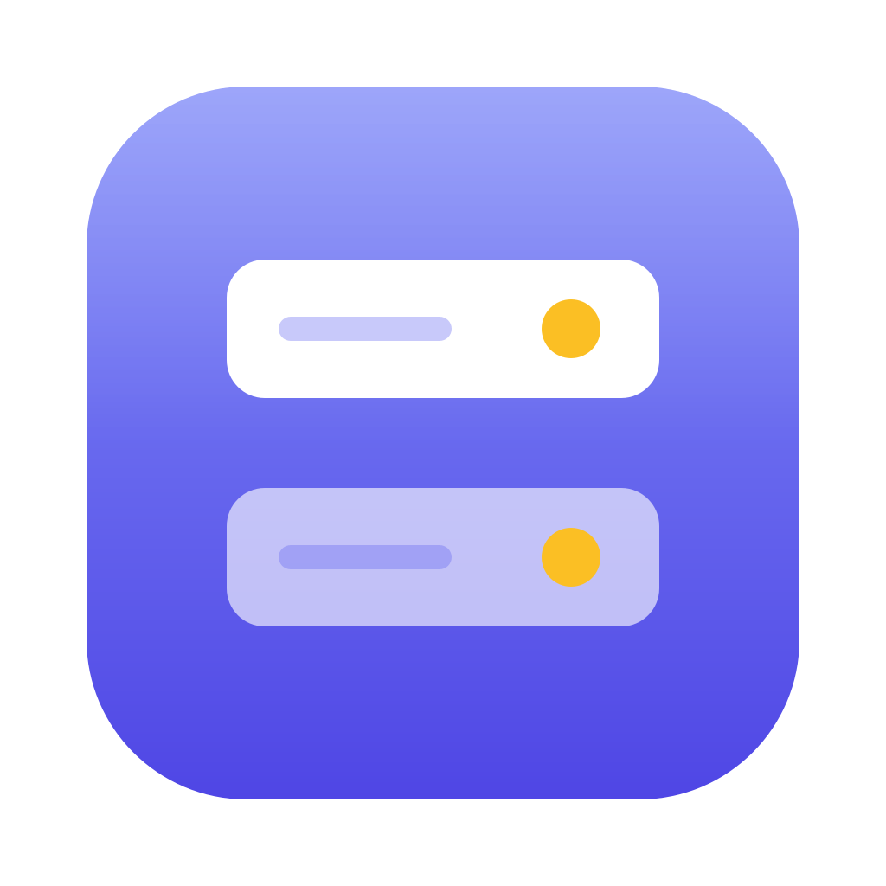
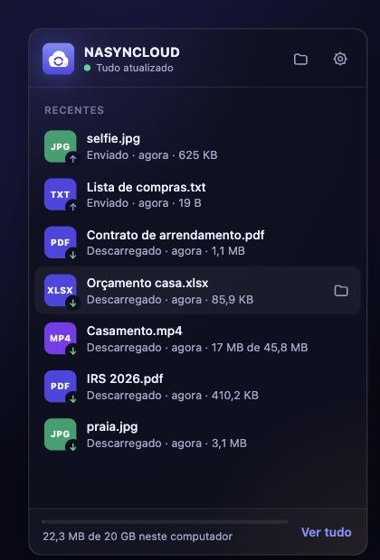
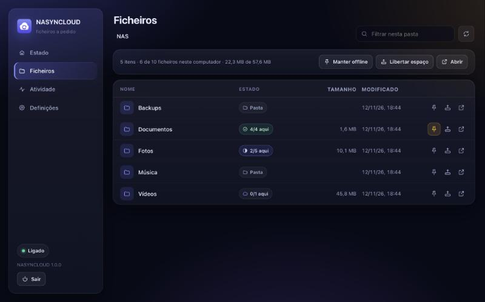

<h1 align="center">NASYNCLOUD</h1>

<b>Your NAS as your own cloud drive.</b> 
See every file on your NAS from your Mac or PC. Only the files you open take up space.

<a href="https://github.com/PedroGrilo/NASYNCLOUD/releases/latest"><b>⬇︎ Download the latest version</b></a>

---

NASYNCLOUD works like OneDrive, Dropbox or iCloud Drive, but your files live on **your** NAS at home instead of on someone else's servers. It was made with UGREEN NAS devices in mind and works with any NAS that supports WebDAV.

> The app's interface is in Portuguese for now. This guide shows each label followed by its meaning in English.

## What it does for you

- 📁 **See everything on your NAS** in a regular folder on your computer, without using disk space.
- ⚡ **Open a file and it's there right away.** A 10 GB movie starts playing at once, without waiting for the whole file.
- ☁️ **Save and forget.** New and changed files are uploaded to the NAS in the background.
- 📌 **Keep offline**: choose the folders you always want with you, even without a connection.
- 🧹 **Free up space**: remove the local copy of a file. It stays on the NAS and in the folder.
- ✈️ **NAS out of reach?** Keep working with what's already on your computer. Your changes are sent when the NAS is back, even if you restarted the computer in the meantime.
- 🛟 **Never lose work.** If a file changes here and on the NAS at the same time, you keep both versions.
- 🔄 **Updates itself.** When a new version comes out, you get a notification and install it with one click.

## What you need

- A **NAS with WebDAV**: UGREEN (UGOS), Synology, QNAP, TrueNAS, Nextcloud and others.
- A **Mac with Apple silicon** (M1 or later) or a **PC with Windows 10 or 11**.
- To be on the same network as your NAS (at home). To use it while away, see the [FAQ](#faq).

## Install in 3 steps

### 1. Turn on WebDAV on your NAS

On a **UGREEN NAS (UGOS)**: open **Control Panel → File Service → WebDAV**, enable WebDAV and click **Apply**. Check that your user can read and write the shared folder you want to use.

On other NAS devices, look for "WebDAV" in the file service or file sharing settings.

### 2. Install NASYNCLOUD

**On a Mac**
1. First install [macFUSE](https://macfuse.github.io/), which lets macOS show your NAS as a folder. When macOS asks, allow it in **System Settings → Privacy & Security**, then restart your Mac.
2. Download `NASYNCLOUD-…-macos-arm64.dmg` from [Releases](https://github.com/PedroGrilo/NASYNCLOUD/releases/latest), open it and drag NASYNCLOUD to **Applications**.
3. The first time you open it, macOS says it can't verify the app (it isn't signed by Apple yet). Go to **System Settings → Privacy & Security** and click **Open Anyway**.

**On Windows** *(experimental)*
1. Download `NASYNCLOUD-…-windows-x64-setup.exe` from [Releases](https://github.com/PedroGrilo/NASYNCLOUD/releases/latest) and run it. It doesn't need administrator rights.
2. If you see "Windows protected your PC", click **More info → Run anyway**.

### 3. Connect to your NAS

The first time, NASYNCLOUD opens **Definições** (Settings). Fill in:

| Field | What to enter | Example |
|---|---|---|
| **Endereço WebDAV** (WebDAV address) | `http://` + your NAS's IP address + `:5005/` + the shared folder's name | `http://192.168.1.50:5005/Shared` |
| **Utilizador** / **Password** (User / Password) | the ones you use to sign in to your NAS | |
| **Pasta onde a NAS aparece** (Folder where the NAS appears) | where you want to see your NAS | `NAS`, in your home folder |

Click **Testar ligação** (Test connection), then **Guardar e ligar** (Save and connect). That's it: your NAS folder shows up in Finder or File Explorer.

> Folder names are case-sensitive (`Photos` is not `photos`). You can find your NAS's IP address in the UGREEN app or on your router's settings page.

## Everyday use

**The icon.** NASYNCLOUD lives in the **menu bar** on a Mac (top right) or in the **notification area** on Windows (bottom right). Click it to open the panel:

- **the status**: «Tudo atualizado» (Up to date), «A enviar 3 ficheiros» (Uploading 3 files), «NAS inacessível» (NAS unreachable)…
- **what's being transferred**, with progress, and what was recently uploaded («Enviado») and downloaded («Descarregado»). Click a file to open it;
- **how much space** your NAS files take on this computer;
- the **folder** button, which opens your NAS in Finder or File Explorer, and the **gear** menu: **Abrir o NASYNCLOUD** (open the full window), **Definições** (Settings), **Pausar** (Pause) and **Sair** (Quit).

**The folder.** Use it like any other folder: open, copy, drag, delete, create folders. Everything you do reaches your NAS.

**Choose what stays on your computer.** In **Abrir o NASYNCLOUD → Ficheiros** (Files) you can see the state of every file and choose, per file or per folder:

| State | Meaning |
|---|---|
| **Só na NAS** (Only on the NAS) | takes no space here; it's downloaded when you open it |
| **Parcialmente aqui** (Partly here) | you opened part of it, like a video you started watching |
| **Neste computador** (On this computer) | fully here; opens even without a connection |
| **Por enviar** (Waiting to upload) | you changed it and it hasn't reached the NAS yet |

- **Manter offline** (Keep offline): downloads everything and keeps it up to date, including new files that show up on the NAS.
- **Libertar espaço** (Free up space): removes the copy on this computer and leaves the file visible in the folder.

On Windows you can also do this from File Explorer: right-click → **Always keep on this device** or **Free up space**.

**Quitting.** Use **Sair do NASYNCLOUD** (Quit NASYNCLOUD) in the gear menu. NASYNCLOUD only closes after it has uploaded anything still pending.

## Updates

NASYNCLOUD checks for new versions on its own. When one is available, you get a **notification** and the panel shows a message: click **Atualizar agora** (Update now) and it installs the update and opens again. You can also check by hand: right-click the icon → **Procurar atualizações** (Check for updates).

Updates are signed: NASYNCLOUD only installs versions published by this project.

## FAQ

**My Mac says it can't open NASYNCLOUD.**
That's because the app isn't signed by Apple yet. Go to **System Settings → Privacy & Security** and click **Open Anyway**. You only need to do this once.

**I see «Falta o macFUSE» (macFUSE is missing).**
Install [macFUSE](https://macfuse.github.io/), allow it in **Privacy & Security**, restart your Mac and open NASYNCLOUD again.

**After an update, my Mac asks to use the Keychain.**
That's expected. NASYNCLOUD keeps your NAS password in the Keychain, and macOS asks again after the app changes. Choose **Always Allow**.

**I can't connect to my NAS.**
Check that:
- WebDAV is turned on on your NAS;
- the address has the right IP and the port `5005`;
- the folder name is spelled exactly as on the NAS;
- your user has access to that folder.

The **Testar ligação** (Test connection) button tells you what's wrong.

**Can I use it away from home?**
Yes, but don't open ports on your router. Use a VPN such as [Tailscale](https://tailscale.com/) or WireGuard, which puts you "at home" wherever you are. Over a VPN, use the address `https://…:5006/…`.

**Do my files go to the internet?**
No. They only travel between your computer and your NAS. Your password is kept in the system's secure storage (Keychain on a Mac, Credential Manager on Windows), and the NASYNCLOUD window can only be opened from your own computer.

**Something went wrong. Where can I see what happened?**
In **Abrir o NASYNCLOUD → Atividade** (Activity). The full log is in `~/Library/Logs/nasyncloud.log` on a Mac and in `%LOCALAPPDATA%\nasyncloud\data\nasyncloud.log` on Windows. If you open an [issue](https://github.com/PedroGrilo/NASYNCLOUD/issues), please include it.

## Project status

| | |
|---|---|
| **macOS** (Apple silicon) | Works and is tested |
| **Windows** | Experimental: builds and passes the tests, but hasn't been used much yet |
| **UGREEN (UGOS)** | Already connects to a real UGREEN NAS. Start with a test folder |
| **Linux** | Command line only (see the [advanced guide](docs/AVANCADO.md)) |

Not there yet: status icons in Finder, and deleting or renaming files that are on the NAS while it's offline (creating and editing files works).

## Going further

These documents are in Portuguese:

- [Advanced guide](docs/AVANCADO.md): command line, every setting, starting at login, and building from source.
- [How it works inside](docs/ARCHITECTURE.md) and [why it's built this way](docs/DECISIONS.md).
- [What changed in each version](CHANGELOG.md).
- If you want to contribute, read [CLAUDE.md](CLAUDE.md) first.
