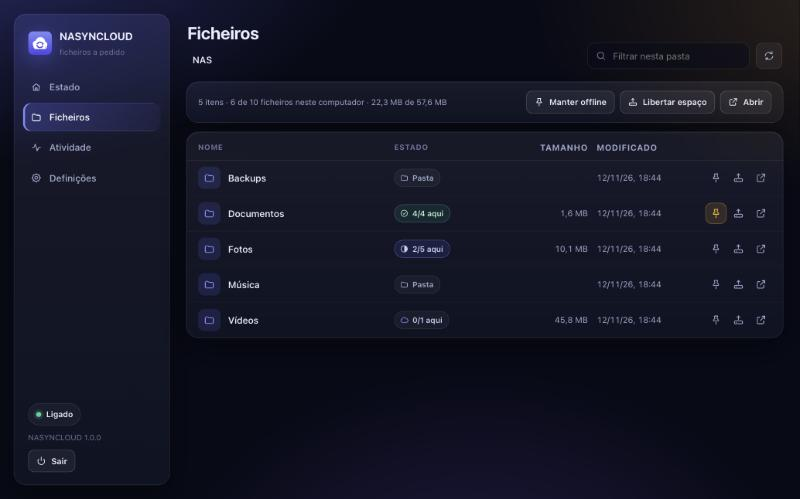

# NASYNCLOUD — guia avançado

Para quem quer usar o NASYNCLOUD pela linha de comandos, afinar as opções, compilar a partir do código ou perceber os limites. Para o uso normal, chega o [README](../README.md).

## Compilar

Precisas do Rust 1.90 ou mais recente (`rustup`).

**Linux** (Debian/Ubuntu):
```sh
sudo apt install fuse3 pkg-config libssl-dev
cargo build --release      # binário em target/release/nasyncloud
```

**macOS**: não é preciso instalar nada além do Rust. O mount é um servidor NFS local (só em 127.0.0.1) montado com o cliente NFS que o macOS já traz, sem administrador nem extensões de sistema. O macFUSE já não é usado (até à 1.0.0 era).
```sh
cargo build --release
tools/package-macos.sh     # opcional: dist/NASYNCLOUD.app e o .dmg
```

**Windows** (toolchain MSVC, Windows 10 1709 ou mais recente, pasta num disco NTFS):
```powershell
cargo build --release      # target\release\nasyncloud.exe
```

## Linha de comandos e browser

```sh
nasyncloud        # o mesmo que: nasyncloud ui
```

Abre a interface no browser e arranca o NASYNCLOUD, se ainda não estiver a correr. Na primeira vez vai direta às **Definições**: endereço WebDAV, utilizador, password e a pasta local onde a NAS deve aparecer. **Testar ligação** confirma tudo antes de guardar e **Guardar e ligar** monta a NAS. Se usares HTTPS com o certificado que vem com a UGOS, o teste avisa que não o consegue verificar e oferece-se para confiar nele.

A interface tem quatro secções:

- **Estado**: ligação, espaço usado, o que falta enviar, problemas e atividade recente, com botões para abrir a pasta e para parar/iniciar. O botão «Sair», em baixo na barra lateral, desmonta a pasta e encerra o NASYNCLOUD, mas só depois de terminar os envios pendentes.
- **Ficheiros**: navegas na NAS e vês o estado de cada ficheiro (só na NAS, parcialmente aqui, neste computador, por enviar). Manter offline, libertar espaço e abrir, por ficheiro ou por pasta.
- **Atividade**: o registo do que o NASYNCLOUD fez.
- **Definições**: a ligação e as opções avançadas.



O NASYNCLOUD continua a correr enquanto o terminal (ou o serviço) estiver aberto; fechar o separador do browser não o para. Voltar a correr `nasyncloud` só reabre a interface. No Windows, um duplo clique no `nasyncloud.exe` faz o mesmo; a janela de consola que aparece é o próprio NASYNCLOUD e fechá-la para-o.

A password fica no cofre do sistema (Gestor de Credenciais no Windows, Porta-chaves no macOS, Secret Service no Linux). Se não houver cofre, a interface pergunta se a pode guardar no ficheiro de definições. Também podes usar a variável `NASYNCLOUD_PASSWORD`.

### Sem browser

```sh
nasyncloud setup     # as mesmas perguntas, no terminal
nasyncloud mount     # monta e sincroniza até Ctrl+C; a interface fica disponível
```

Com o `mount` a correr, `nasyncloud ui` abre a interface a qualquer momento.

### Linux e macOS na linha de comandos

A pasta comporta-se como qualquer outra (`cp`, `mv`, editores, `rsync`...). Para gerir o que fica local sem a interface:

```sh
nasyncloud status                 # estado geral: ligação, cache, uploads pendentes
nasyncloud ls ~/NAS/Fotos         # estado de cada entrada
nasyncloud pin ~/NAS/Documentos   # manter offline
nasyncloud unpin ~/NAS/Documentos
nasyncloud free ~/NAS/Videos      # libertar espaço já
nasyncloud refresh ~/NAS/Fotos    # reler da NAS agora
nasyncloud unmount                # se uma sessão anterior ficou pendurada
```

No Linux, `du` mostra o espaço que cada coisa ocupa mesmo no disco; `ls -l` mostra o tamanho real na NAS. No macOS, o `du` mostra sempre o tamanho todo (o cliente NFS calcula-o a partir do tamanho): usa `nasyncloud ls` ou `nasyncloud status`.

No macOS, estes comandos falam com o serviço pela API local (a mesma da interface), por isso só funcionam com o NASYNCLOUD a correr. No Linux usam atributos estendidos no próprio mount.

### Windows

Para além da interface, tudo funciona no Explorador: a pasta aparece no painel lateral com os ícones de nuvem (só online) e visto verde (no disco). Clique direito → **Manter sempre neste dispositivo** ou **Libertar espaço**. O Sensor de Armazenamento também pode libertar espaço sozinho. Para remover o registo da pasta no Windows (os ficheiros na NAS não são tocados): `nasyncloud unregister`.

## Arrancar automaticamente

Corre `nasyncloud mount` no arranque; a interface abre-se depois com `nasyncloud ui`.

**Linux (systemd)**: `~/.config/systemd/user/nasyncloud.service`
```ini
[Unit]
Description=nasyncloud
After=network-online.target

[Service]
ExecStart=%h/.cargo/bin/nasyncloud mount
Restart=on-failure

[Install]
WantedBy=default.target
```
e depois `systemctl --user enable --now nasyncloud`.

**Windows**: no Agendador de Tarefas, uma tarefa "Ao iniciar sessão" que corre `nasyncloud.exe mount`.

**macOS**: um LaunchAgent em `~/Library/LaunchAgents` com `ProgramArguments` = `nasyncloud mount` e `KeepAlive` ativo.

## Configuração

A interface mostra onde está o ficheiro (no Linux, `~/.config/nasyncloud/config.toml`). Também podes usar `--config caminho`. Opções avançadas (todas editáveis na interface):

| Chave | Omissão | O que faz |
|---|---|---|
| `cache_max_size` | `"20G"` | Limite da cache (Linux/macOS). Acima disto, os ficheiros usados há mais tempo são libertados. Fixados e modificados nunca. |
| `cache_dir` | pasta de cache do sistema | Onde ficam os dados descarregados e o índice. |
| `dir_ttl_secs` | `30` | Quanto tempo uma listagem de pasta é usada antes de perguntar à NAS outra vez. |
| `poll_interval_secs` | `300` | De quanto em quanto tempo as pastas fixadas (e, no Windows, todas as pastas já abertas) são comparadas com a NAS. No Windows, uma pasta que se abre no Explorador é relida ao fim de `dir_ttl_secs`, sem esperar por isto. |
| `upload_delay_secs` | `2` | Pausa depois de fechar um ficheiro antes de o enviar. |
| `parallel_uploads` | `2` | Uploads em simultâneo. |
| `readahead_mb` | `8` | Quanto o download pode ir à frente da leitura. |
| `atomic_upload` | `true` | Upload para nome temporário + renomear. Se a NAS não deixar, passa sozinho para upload direto. |
| `accept_invalid_certs` | `false` | Aceitar certificados HTTPS que não se conseguem verificar. |
| `ui_port` | `8730` | Porta da interface (`http://127.0.0.1:8730`). |
| `exclude` | `[]` | O que fica só neste computador, por exemplo `[".git", "node_modules", "*.log"]`. Ver abaixo. |

### Excluir da sincronização

O que corresponder a uma destas regras nunca é enviado para a NAS e, se a NAS já o tiver, não aparece aqui (lá fica intacto). Quando uma pasta corresponde, tudo o que está dentro dela também. Maiúsculas e minúsculas tanto faz.

| Regra | Apanha |
|---|---|
| `node_modules` | ficheiros e pastas com esse nome, em qualquer sítio |
| `*.log`, `cache-?` | `*` é qualquer sequência de caracteres e `?` um só, dentro de um nome |
| `build/` | só pastas com esse nome |
| `/dist`, `Fotos/RAW` | um caminho a partir da pasta da NAS (há uma barra no início ou a meio); `**` vale por qualquer número de pastas (`src/**/gen`) |

Ao mudar as regras, a ligação reinicia. O que passou a estar excluído e só era uma cópia da NAS desaparece daqui; o que tinha alterações feitas neste computador fica, só aqui. O que deixou de estar excluído é enviado. Apagar ou renomear um item excluído criado aqui nunca mexe na NAS.

`-v` dá mais detalhe no registo.

## Segurança da interface

- Só escuta em `127.0.0.1`; não é acessível de outros computadores.
- A API exige um token aleatório de 256 bits, guardado em `ui.json` ao lado das definições (só a tua conta o lê). `nasyncloud ui` abre o browser já com ele.
- Pedidos com outro `Host` são recusados (proteção contra DNS rebinding) e a página tem uma Content-Security-Policy restritiva.
- Quem tem acesso à tua conta no computador consegue usar a interface, tal como consegue abrir a pasta da NAS.

## Limitações conhecidas

- **Linux/macOS**: apagar ou renomear algo que já está na NAS precisa da NAS acessível (offline dá "Host is down" no Linux e "Input/output error" no macOS). Criar e editar funciona offline. Pastas nunca abertas não se podem ver offline.
- **Windows**: as alterações feitas na NAS por outros dispositivos aparecem quando se abre a pasta (no máximo uma vez por `dir_ttl_secs`) ou na sondagem seguinte (`poll_interval_secs`, mínimo 15 s). Nomes que o Windows não aceita (`:`, `?`, `CON`...) são ignorados, com aviso.
- **macOS**: não há ícones de estado no Finder (isso exigiria uma extensão File Provider assinada). O `du` não reflete o que está no disco (ver acima). Os atributos estendidos (etiquetas, quarentena, …) funcionam enquanto o NASYNCLOUD corre, mas ficam só em memória: não vão para a NAS e perdem-se quando ele para. O espaço livre que o Finder mostra é fixo (1 TiB), não o da NAS. Se o serviço morrer sem desmontar (por exemplo, `kill -9`), quem estiver a usar a pasta fica à espera até o NASYNCLOUD voltar a arrancar, e nessa altura o mount antigo é retirado.
- Permissões (`chmod`/`chown`), links simbólicos e atributos estendidos não são guardados na NAS.
- `.DS_Store`, `Thumbs.db`, `desktop.ini`, `~$*`, `*.tmp` e afins ficam só no computador, tal como o que estiver em `exclude`.
- Os uploads deixam temporariamente ficheiros `.*.nasyncloud-part` na NAS; restos com mais de um dia são apagados sozinhos.
- As mensagens da secção Atividade (e da linha de comandos) estão em inglês.

## Para quem desenvolve

- [`CLAUDE.md`](../CLAUDE.md): contexto rápido do projeto, comandos e armadilhas. Lê primeiro.
- [`docs/ARCHITECTURE.md`](ARCHITECTURE.md): como funciona por dentro.
- [`docs/DECISIONS.md`](DECISIONS.md): porque é que foi feito assim.
- [`CHANGELOG.md`](../CHANGELOG.md).
- Testes: `cargo test`; num mount real (Linux ou macOS), `cargo build && cargo build --example fake_nas && tests/e2e.sh` (usa o rclone como NAS se estiver instalado, senão a NAS falsa `examples/fake_nas.rs`). Ambiente de demonstração (Linux): `tools/demo.sh`.
